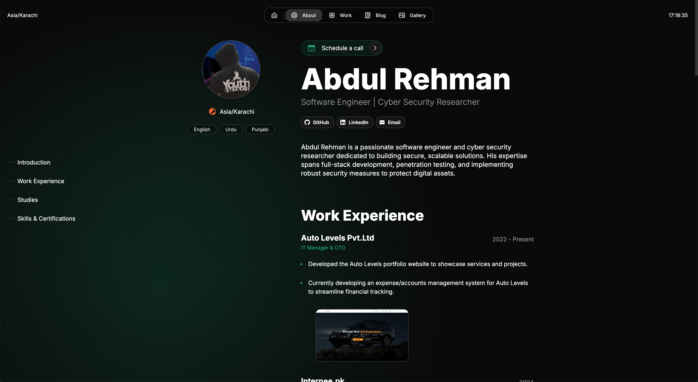

> **Cloudflare migration:** The new portfolio and D1-backed admin/order/blog platform is in [`cloudflare/`](cloudflare/README.md). The original Next.js/Vercel application below remains intact until the migration is configured and verified.

# Abdul Rehman's Portfolio

Welcome to **Abdul Rehman's Portfolio**, a modern, responsive, and interactive website showcasing my work as a **Software Engineer** and **Cyber Security Researcher**. This portfolio highlights my skills, projects, certifications, and professional experience in a visually appealing and user-friendly manner.

---

## 🌟 Features

- **Responsive Design**: Optimized for all devices with support for dark and light themes.
- **Dynamic Content**: Blog posts and project details are powered by MDX for easy updates.
- **Interactive Animations**: Smooth animations for an engaging user experience.
- **SEO Optimized**: Metadata and structured data for improved search engine visibility.
- **Accessible**: Built with accessibility in mind to ensure inclusivity.

---

## 🛠️ Tech Stack

- **Frontend**: [Next.js](https://nextjs.org/), [React](https://reactjs.org/), [TypeScript](https://www.typescriptlang.org/)
- **Styling**: [SCSS](https://sass-lang.com/), [Once UI Components](https://once-ui.com/)
- **Content Management**: MDX for blog posts and project descriptions
- **Performance**: Lazy loading, optimized images, and server-side rendering
- **Deployment**: Hosted on [Vercel](https://vercel.com/)

---

## 📂 Project Structure

```
AbdulPortfolio/
├── components/       # Reusable React components
├── pages/            # Next.js pages
├── public/           # Static assets (images, icons, etc.)
├── styles/           # SCSS stylesheets
├── data/             # MDX files for blog posts and projects
├── utils/            # Utility functions
└── README.md         # Project documentation
```

---

## 🚀 Getting Started

### Prerequisites
- [Node.js](https://nodejs.org/) (v16 or higher)
- [npm](https://www.npmjs.com/) or [yarn](https://yarnpkg.com/)

### Installation

1. Clone the repository:
   ```bash
   git clone https://github.com/your-username/AbdulPortfolio.git
   cd AbdulPortfolio
   ```

2. Install dependencies:
   ```bash
   npm install
   # or
   yarn install
   ```

3. Start the development server:
   ```bash
   npm run dev
   # or
   yarn dev
   ```

4. Open your browser and navigate to:
   ```
   http://localhost:3000
   ```

---

## 📦 Deployment

This project is deployed using [Vercel](https://vercel.com/). To deploy your own version:

1. Push your code to a GitHub repository.
2. Connect your repository to Vercel.
3. Vercel will automatically build and deploy your project.

---

## 📑 Sections

### 1. **About**
   - A detailed introduction to my professional background and achievements.

### 2. **Work Experience**
   - A timeline of my roles, responsibilities, and accomplishments.

### 3. **Technical Skills**
   - A categorized list of my technical expertise, tools, and certifications.

### 4. **Certifications**
   - Professional certifications with descriptions and links.

### 5. **Projects**
   - A showcase of my completed projects with descriptions, visuals, and challenges faced.

### 6. **Blog**
   - Technical articles and insights on software engineering and cybersecurity.

### 7. **Gallery**
   - A curated collection of images showcasing my work.

### 8. **Contact**
   - Professional contact details and a form for inquiries.

---

## 🛡️ Security

If you discover any security vulnerabilities, please report them by emailing me at **[iamabdulrehman.technophile@gmail.com]**. All reports will be promptly addressed.

---

## 🤝 Contributing

Contributions are welcome! If you'd like to contribute:

1. Fork the repository.
2. Create a new branch:
   ```bash
   git checkout -b feature/your-feature-name
   ```
3. Commit your changes:
   ```bash
   git commit -m "Add your message here"
   ```
4. Push to the branch:
   ```bash
   git push origin feature/your-feature-name
   ```
5. Open a pull request.

---

## 📄 License

This project is licensed under the **MIT License**. See the [LICENSE](LICENSE) file for details.

---

## 📧 Contact

Feel free to reach out to me:

- **Email**: [iamabdulrehman.technophile@gmail.com](mailto:iamabdulrehman.technophile@gmail.com)
- **LinkedIn**: [linkedin.com/in/abdulrehmansarwar](https://linkedin.com/in/abdulrehmansarwar)
- **GitHub**: [github.com/abdulrehman-dev-ai](https://github.com/abdulrehman-dev-ai)

---

## 📷 Screenshots

### Home Page


---

Thank you for visiting my portfolio! 😊# abdulrehman
